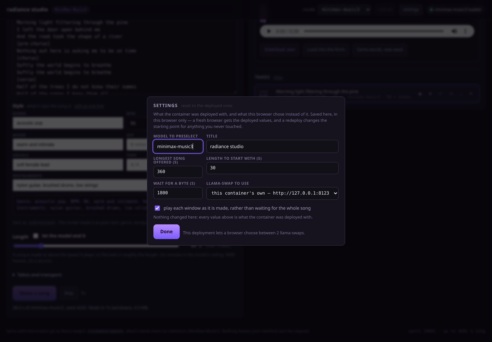

# radiance studio


A small web GUI for [MiniMax-Music3](https://huggingface.co/MiniMaxAI/MiniMax-Music3) on
[radiance](https://codeberg.org/StillDeadcode/radiance): write lyrics, describe the song, get a
song. It is one nginx container — the page is static files and a reverse proxy, so there is no node
server, no build step, and nothing to keep warm.

The image is published at
[`ghcr.io/apfrancis1992/radiance-studio`](https://github.com/users/apfrancis1992/packages/container/package/radiance-studio)
and [`deploy/stack.yml`](deploy/stack.yml) is the compose to paste into Komodo.

It talks to **llama-swap**, not to radiance directly. Each request names a model in its body, so
llama-swap loads the 20 GiB checkpoint when you ask for a song and gives the cards back to whatever
else you run when you are done. The header has an *unload* button, which is `POST
/api/models/unload` — the useful button on a machine with two cards and five models.

```
browser ──/v1/audio/speech──▶ this container ──▶ llama-swap :8080 ──▶ radiance --model minimax-music3-bf16.rad --tp 2
           (same origin,        nginx: serves the   (loads the model    (its own container, started
             no CORS, no key     page, adds the key,  on demand, swaps   by llama-swap's `cmd`)
             in the browser)     does not buffer)     it for others)
```

## The request

One route does the whole thing, and every field is the model's own, spelled as radiance's
`/v1/audio/speech` takes it (radiance's `docs/GUIDE.md` §5.15):

| the page sends | |
|---|---|
| `model` | the name llama-swap's config gives the entry — the page lists what `/v1/models` answers and preselects the music one |
| `input` | the lyrics, with the model's section tags (`[verse]`, `[chorus]`, `[bridge]`…) |
| `instructions` | the description: genre, BPM, key, time signature, mood, vocals, instruments. Seven fields spell it for you, or edit it as one line |
| `duration` | seconds, to 360 (9000 frames at 25 a second); tick *ask in frames* to send the same length as `max_new_tokens` instead, which is the unit the model counts in. One or the other — the route refuses both |
| `seed` | `-1` for a fresh one. The server answers with `X-Seed`, which is what the take list stores, so a take you liked is reproducible and one you did not can be rerolled with everything else held still |
| `num_inference_steps`, `guidance_scale` | the denoiser's, 30 and 1.7 as the model ships |
| `stream`, `stream_format`, `response_format` | which of the three ways the song comes back, below |

Three ways it comes back, and the page offers all three:

| chosen | what goes over the wire | what you get |
|---|---|---|
| **as windows** | `stream: true` with `response_format: pcm`: SSE events, each carrying base64 PCM | eight seconds of song in seconds, then a four-second window playing as it lands |
| **as raw bytes** | `stream_format: audio` with a `response_format`: the audio itself, chunked, behind a header whose sizes are still unknown | a count of what has arrived, then the whole thing from the start |
| **as one file** | nothing streamed | nothing at all until the song is finished |

Streaming is worth the default. A song is made at about the speed it plays and its first window of
eight seconds arrives in seconds — so you hear the beginning while the rest is being written,
instead of sitting through the whole render before the first byte arrives. However it came, the page
writes the same samples into a wav as they land and hands that finished file to the player, the
download link and the take list, so all three routes end in the same artifact. Which one a take came
by is written under it in the list.

Both directions keep the headers that matter: `X-Seed`, `X-Audio-Sample-Rate`, `X-Audio-Channels`
come back through the proxy untouched, and an error from the route arrives with its `param` and its
`supported` values, so a refusal names the field.

That is the whole route. OpenAI's `voice`, `speed` and `user` radiance accepts and ignores for this
model — the voice is described in the words, and the tempo is in the description — and `references`
belongs to a voice-cloning model, which this is not; the page sends none of them, because the route
refuses a field it does not have rather than shrugging at one.

## Files

```
public/            what the browser gets, as it stands
  index.html         the form, the player and the settings dialog
  app.js             the form, the request, the take list
  audio.js           the wire format: SSE events, base64 PCM, raw bytes, wav writing, window-by-window playback
  settings.js        the deployed defaults from /config.json, overruled per browser in localStorage
  store.js           the takes, in IndexedDB, with the eviction pass that keeps them bounded
  style.css          one stylesheet, no framework
docker/10-upstream-map.sh   writes the X-Upstream allow-list into nginx's conf.d when the container starts
nginx/default.conf.template   the server; envsubst'd by the container's entrypoint at start
deploy/stack.yml              the Komodo stack (a plain compose file too)
deploy/env.example            every setting, with what it is for
deploy/llama-swap.yaml        the model entry to paste into llama-swap's config
scripts/publish.sh            build, push to ghcr.io, and print the stack to paste
scripts/check-stack.sh        what Komodo would be given, checked before it is given
scripts/template-vars.sh      the variable names the image's ENV block defines, which those two compare
scripts/build.sh              a local tag, for changing the page
dev/                        no GPU needed: mock-upstream.py, run.sh, smoke.mjs, check-page.mjs, shot.mjs
docs/                       screenshot.png, settings.png
Dockerfile                  nginx plus those files
```

## Run it

### 1. Publish the image

```sh
gh auth refresh --hostname github.com -s write:packages    # once: gh >= 2.9x, `gh auth refresh-token` before that
scripts/publish.sh                                        # -> ghcr.io/apfrancis1992/radiance-studio:<sha> and :latest
```

The token is piped to `docker login`, not written into a file. Nothing is compiled, so the build is
a second and the image is nginx plus 60 KB of files.

The first push creates the package **private**, and ghcr gives no API for the switch -- the packages
endpoints answer 404 for container packages, whatever token asks -- so `publish.sh` does not guess.
It asks the registry the question a deploy actually depends on, anonymously: token exchange, then
the manifest, the same two calls a credential-less host makes. If the answer is no it prints the one
web-UI click (`Package settings → Change visibility → Public`) and re-probes for two minutes while
you make it. `scripts/publish.sh --check` re-asks at any time. With a private package instead,
`docker login ghcr.io` on the host Komodo deploys to (or a Registry provider on the stack) is what
makes the pull work.

For a change to the page while it is being written, `scripts/build.sh` tags a local image and
`dev/run.sh` serves it.

### 2. llama-swap

`deploy/llama-swap.yaml` is the model entry, with the two settings that a 20 GiB checkpoint needs
and a GGUF does not: `healthCheckTimeout` long enough for the load, and no deadline on the wait for
a response's first byte (which, unstreamed, is the whole render).

### 3. Komodo

*Stacks → New Stack*, paste the output of `scripts/publish.sh --compose` -- `deploy/stack.yml` with
the image line pinned to the commit it just pushed -- and put `deploy/env.example`'s values in the
stack's environment (or use it as an env file). Deploy.

Pinned rather than floating on purpose: with `:latest`, Komodo's *Poll for Updates* / *Auto Update*
pulls whatever was pushed last and redeploys, which is a fine thing to want for a page and a poor
thing to discover in the middle of a session. Raise the tag to a new sha when you want it.

The container shares the host's network, as radiance's own containers do, so the port in `PORT` is
the port on the host and `UPSTREAM_URL` can be the host's own loopback. Komodo's healthcheck reads
`/healthz`, which says this container is serving — the model is llama-swap's business, and the pill
in the header reads llama-swap's `/health` and `/running` for that.

Changing any setting is a redeploy: nginx reads the environment once, at start.

Two things make that lighter than it sounds. Most of the settings the stack can set — the title, the
model to preselect, the length ceiling and its default, the timeout, the transport a new song starts
on, which llama-swap to reach — are also in the page's settings panel, so what you deploy is the
starting point rather than the only chance to get it right. And a key does not belong in the stack's
environment as a literal: make it a Komodo variable with the *secret* option and write
`UPSTREAM_API_KEY=[[llama_swap_key]]`, which is how Komodo interpolates its own variables. The `${…}`
you see elsewhere in the stack is Docker Compose's, resolved on the target from the environment file
Komodo writes there, and the image's defaults are what a stack that names nothing gets.

### Without Docker, without a GPU

```sh
dev/run.sh                    # builds, starts two mock llama-swaps, serves http://127.0.0.1:8090
npm install                   # puppeteer-core, dev-only
node dev/check-page.mjs       # every id the page asks for exists, every import resolves
python3 dev/mock-upstream.py --selftest    # the mock's refusals against radiance's wording
node dev/smoke.mjs            # 52 checks in a real browser: three transports → wav → IndexedDB → settings → reload
sh scripts/check-stack.sh     # the stack, the template's variables, and the pinned image line
node dev/shot.mjs             # docs/screenshot.png and docs/settings.png
```

`dev/mock-upstream.py` answers the same four routes with a synthesised chord in the same shapes, and
refuses a bad request the way `core/server/audio_gen.cpp` does — the same fields, the same bounds,
the same words, down to `duration: expected seconds in (0, 360]`. That is what makes a GPU-less run
worth anything: a page that only ever pleases the mock has been checked against what the real route
accepts. `--selftest` holds the mirror up to itself, so the wording is tested rather than trusted.
The second mock exists so the *X-Upstream* allow-list is exercised too: one answers to
`minimax-music3`, the other to `minimax-lab` and says nothing is loaded.

CI (`.woodpecker.yml`) runs the checks that need no browser: the module syntax, the mock's refusals,
the template rendered with the image's own defaults and tested by nginx's own `-t`, and
`scripts/check-stack.sh`.

## Settings

The image tag is compose's variable; the rest arrive in the container's environment and nginx
substitutes them once, at start.

| variable | default | what it is |
|---|---|---|
| `IMAGE` | `ghcr.io/apfrancis1992/radiance-studio:latest` | which image to run; `scripts/publish.sh --compose` prints the stack with this pinned to a commit sha |
| `PORT` | `8090` | the port, on the host |
| `UPSTREAM_URL` | `http://127.0.0.1:8080` | llama-swap. A bridge network wants the container name |
| `UPSTREAM_API_KEY` | *(empty)* | llama-swap's `apikey:`, sent as `Authorization: Bearer …`; empty sends no header. Never reaches the browser |
| `MODEL` | *(empty)* | the model id to preselect; empty picks the first id that looks like a music model |
| `APP_TITLE` | `radiance studio` | the header |
| `STREAM_DEFAULT` | `true` | whether streaming starts ticked |
| `MAX_DURATION` | `360` | the length slider's ceiling; 360 is the model's |
| `DEFAULT_DURATION` | `30` | and its starting value |
| `REQ_TIMEOUT` | `1800` | how long a request may go without a byte, in seconds — sized for a cold load |
| `RESOLVER` | `127.0.0.11` | only consulted if `UPSTREAM_URL` names a host rather than an address |
| `UPSTREAM_OPTIONS` | `[]` | a JSON array of `label`/`url` pairs a browser may pick instead of `UPSTREAM_URL`; both a dropdown and an allow-list, below |
| `VERSION` | the commit the image was built from | `/config.json` and the footer say which build you are looking at; `scripts/publish.sh` passes it in, so nobody sets it by hand |

### …and the same settings, from the browser



Everything above except the key, the port and the resolver can be changed in the page instead of in
Komodo. *settings* opens the panel; the container hands it its own values over `/config.json`, and
what you change is saved in that browser:

```
/config.json ──what the deployment says──▶ settings.js ──merged with──▶ localStorage (this browser)
                                              │
                    the header's title, the length ceiling and its starting value, which transport a
                    new song defaults to, the timeout the page quotes, the model to preselect, and
                    which llama-swap to reach
```

- A fresh browser, or someone else's, gets exactly what the container was deployed with.
- A change is used immediately — the ceiling moves the slider, the title moves the header — and
  survives a reload. The footer counts how many this browser overruled; *reset to the deployed ones*
  puts them back.
- A redeploy changes the starting point only for settings nobody overruled, which is the point: the
  deployment is the default, not the lock.
- Not in the panel, on purpose: `UPSTREAM_API_KEY` (it never leaves the container, and the browser
  never sees it), `PORT` and `RESOLVER`, which belong to the host rather than to the page.

### One page, two llama-swaps

`UPSTREAM_OPTIONS` is a dropdown and an allow-list at once:

```yaml
UPSTREAM_OPTIONS: >-
  [{"label": "the box under the desk", "url": "http://127.0.0.1:8080"},
   {"label": "the one in the other room", "url": "http://192.168.1.30:8080"}]
```

- With anything in it, the panel offers those targets and the page sends `X-Upstream: <url>` on every
  llama-swap call — the model list, the health pill, the unload, and the song itself — so one
  deployed page can be aimed at a second server without redeploying anything.
- nginx honours the header only when it names a URL on that list, matched whole
  (`docker/10-upstream-map.sh` turns the list into a `map` when the container starts), and `[]` — the
  default — means the header does nothing at all. A caller cannot turn this container into an open
  proxy, because there is nothing it is allowed to name.
- The container's `UPSTREAM_API_KEY` rides along to whichever target is chosen, so list only hosts
  that should see your key. The key itself is never sent to the browser.
- A target is `scheme://host[:port]` with no path; anything else is skipped at start, and the
  container's log says which ones it accepted.

## What the page keeps

Nothing on the server: no accounts, no database, no volume. The takes live in the browser that made
them, in IndexedDB — the wav, the words, the description, the length, the seed, the denoiser's
settings and which transport brought it back — and the newest 24 (or 400 MB, whichever comes first)
are kept; star a take and eviction leaves it alone. *Download .wav* writes it out if you want it
somewhere permanent.

The lyrics you are typing are a `localStorage` draft, so a reload does not lose them, and so are the
settings above: one browser's memory, three keys, no server to forget them in.

## Troubleshooting

| what you see | what it is |
|---|---|
| `model 'x' not found` | `MODEL`, or the picker, names something llama-swap's config does not have. It wants the config's key, not the `.rad` file |
| minutes of nothing, then a failure | llama-swap gave up waiting for radiance's `/health`. Raise `healthCheckTimeout`; watch `docker logs -f` for the model llama-swap started |
| a whole (unstreamed) song dies around a minute in | llama-swap's `timeouts.responseHeader` for that model, or an nginx in front of *this* container buffering. Stream instead, or set `responseHeader: 0` |
| `502` with the container up | `UPSTREAM_URL` is wrong, or llama-swap is not listening on it |
| `503` saying the server is overloaded | radiance makes four songs at once and its queue is full — try again, or lower `--max-queued-requests` expectations |
| the second card set never gets used | llama-swap holds the cards for the model that ran last. *unload*, or `POST /api/models/unload` |
| a six minute song never finishes | a song is made at about the speed it plays; on one card it is slower than that. Check `radiance` logs rather than assuming the page hung |
| nothing plays until you click | browsers will not start audio on their own; the first click on *Make a song* is what unlocks it |
| the llama-swap choice does nothing | `UPSTREAM_OPTIONS` is empty — `/config.json` answers `"upstreamOptions":[]` — or the entry was skipped: a target is `scheme://host[:port]` with no path, and the container's start log lists what it accepted |
| the model list emptied after you changed a setting | the page is now asking a different llama-swap (the footer names it); the panel's first choice puts it back, and *reset* forgets every change this browser made |

## Not (yet)

- No server-side library, so takes do not cross browsers — nor do settings, which are one browser's
  `localStorage` over the deployment's defaults. A volume and a manifest would make the takes shared;
  the store is already the only place the audio is held.
- Music only. Breeze-TTS-2 and drama-3 share the route with different fields, and a speech mode is a
  second panel over the same transport.
- One key, per container. Anyone who can reach the port can make songs, and can read the settings
  panel — which is why the key is not in it.

## Licence

Apache-2.0, as radiance is (`LICENSE`). MiniMax-Music3 itself carries its own terms on Hugging Face,
and a song you publish is your business.
