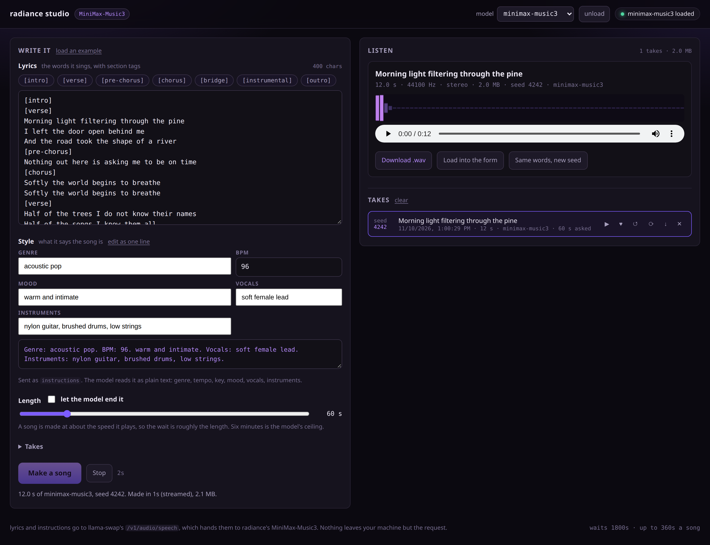

# radiance studio



A small web GUI for [MiniMax-Music3](https://huggingface.co/MiniMaxAI/MiniMax-Music3) on
[radiance](https://codeberg.org/StillDeadcode/radiance): write lyrics, describe the song, get a
song. It is one nginx container — the page is static files and a reverse proxy, so there is no node
server, no build step, and nothing to keep warm.

The image is published at
[`ghcr.io/apfrancis1992/radiance-studio`](https://github.com/users/apfrancis1992/packages/container/package/radiance-studio)
and [`deploy/stack.yml`](deploy/stack.yml) is the compose to paste into Komodo.

It talks to **llama-swap**, not to radiance directly. Each request names a model in its body, so
llama-swap loads the 20 GiB checkpoint when you ask for a song and gives the cards back to whatever
else you run when you are done. The header has an *unload* button, which is `POST
/api/models/unload` — the useful button on a machine with two cards and five models.

```
browser ──/v1/audio/speech──▶ this container ──▶ llama-swap :8080 ──▶ radiance --model minimax-music3-bf16.rad --tp 2
           (same origin,        nginx: serves the   (loads the model    (its own container, started
             no CORS, no key     page, adds the key,  on demand, swaps   by llama-swap's `cmd`)
             in the browser)     does not buffer)     it for others)
```

## The request

One route does the whole thing, and every field is the model's own, spelled as radiance's
`/v1/audio/speech` takes it (radiance's `docs/GUIDE.md` §5.15):

| the page sends | |
|---|---|
| `model` | the name llama-swap's config gives the entry — the page lists what `/v1/models` answers and preselects the music one |
| `input` | the lyrics, with the model's section tags (`[verse]`, `[chorus]`, `[bridge]`…) |
| `instructions` | the description: genre, BPM, mood, vocals, instruments. Five fields spell it for you, or edit it as one line |
| `duration` | seconds, to 360 (9000 frames at 25 a second); or give nothing and let the model stop at the end of the lyrics |
| `seed` | `-1` for a fresh one. The server answers with `X-Seed`, which is what the take list stores, so a take you liked is reproducible and one you did not can be rerolled with everything else held still |
| `num_inference_steps`, `guidance_scale` | the denoiser's, 30 and 1.7 as the model ships |
| `stream`, `response_format` | streaming, which is the default: `stream: true` with `response_format: pcm` |

Streaming is worth the default. A song is made at about the speed it plays and its first window of
eight seconds arrives in seconds — so you hear the beginning while the rest is being written,
instead of sitting through the whole render before the first byte arrives. The page plays each
window as it lands through Web Audio, writes the same samples to a wav as it goes, and hands the
finished file to the player, the download link and the take list.

Both directions keep the headers that matter: `X-Seed`, `X-Audio-Sample-Rate`, `X-Audio-Channels`
come back through the proxy untouched, and an error from the route arrives with its `param` and its
`supported` values, so a refusal names the field.

## Files

```
public/            what the browser gets, as it stands
  index.html         the form and the player
  app.js             the form, the request, the take list
  audio.js           the wire format: SSE events, base64 PCM, wav writing, window-by-window playback
  store.js           the takes, in IndexedDB, with the eviction pass that keeps them bounded
  style.css          one stylesheet, no framework
nginx/default.conf.template   the server; envsubst'd by the container's entrypoint at start
deploy/stack.yml              the Komodo stack (a plain compose file too)
deploy/env.example            every setting, with what it is for
deploy/llama-swap.yaml        the model entry to paste into llama-swap's config
scripts/publish.sh            build, push to ghcr.io, and print the stack to paste
scripts/check-stack.sh        what Komodo would be given, checked before it is given
scripts/build.sh              a local tag, for changing the page
dev/                        no GPU needed: mock-upstream.py, run.sh, smoke.mjs, check-page.mjs, shot.mjs
Dockerfile                  nginx plus those files
```

## Run it

### 1. Publish the image

```sh
gh auth refresh --hostname github.com -s write:packages    # once: gh >= 2.9x, `gh auth refresh-token` before that
scripts/publish.sh                                        # -> ghcr.io/apfrancis1992/radiance-studio:<sha> and :latest
```

The token is piped to `docker login`, not written into a file. Nothing is compiled, so the build is
a second and the image is nginx plus 60 KB of files.

The first push creates the package **private**, which ghcr does not let you decide at push time;
`publish.sh` flips it with the packages API and, when the token cannot, prints where the switch is.
It then checks the thing that matters -- an anonymous token exchange and a manifest fetch, the same
two calls a host with no credentials makes -- so "public" is measured rather than assumed. With a
private package, `docker login ghcr.io` on the host Komodo deploys to (or a Registry provider on
the stack) is what makes the pull work.

For a change to the page while it is being written, `scripts/build.sh` tags a local image and
`dev/run.sh` serves it.

### 2. llama-swap

`deploy/llama-swap.yaml` is the model entry, with the two settings that a 20 GiB checkpoint needs
and a GGUF does not: `healthCheckTimeout` long enough for the load, and no deadline on the wait for
a response's first byte (which, unstreamed, is the whole render).

### 3. Komodo

*Stacks → New Stack*, paste the output of `scripts/publish.sh --compose` -- `deploy/stack.yml` with
the image line pinned to the commit it just pushed -- and put `deploy/env.example`'s values in the
stack's environment (or use it as an env file). Deploy.

Pinned rather than floating on purpose: with `:latest`, Komodo's *Poll for Updates* / *Auto Update*
pulls whatever was pushed last and redeploys, which is a fine thing to want for a page and a poor
thing to discover in the middle of a session. Raise the tag to a new sha when you want it.

The container shares the host's network, as radiance's own containers do, so the port in `PORT` is
the port on the host and `UPSTREAM_URL` can be the host's own loopback. Komodo's healthcheck reads
`/healthz`, which says this container is serving — the model is llama-swap's business, and the pill
in the header reads llama-swap's `/health` and `/running` for that.

Changing any setting is a redeploy: nginx reads the environment once, at start.

### Without Docker, without a GPU

```sh
dev/run.sh                    # builds, starts dev/mock-upstream.py, serves http://127.0.0.1:8090
npm install                   # puppeteer-core, dev-only
node dev/check-page.mjs       # every id app.js asks for exists, every import resolves
node dev/smoke.mjs            # 18 checks in a real browser: form → SSE → wav → IndexedDB → reload
sh scripts/check-stack.sh     # the stack, the template's variables, and the pinned image line
node dev/shot.mjs             # docs/screenshot.png
```

`dev/mock-upstream.py` answers the same four routes with a synthesised chord in the same shapes, so
a change can be driven end to end with no cards in the loop. CI (`.woodpecker.yml`) runs the checks
that need no browser: the module syntax, the template rendered with the image's own defaults and
tested by nginx itself, and `scripts/check-stack.sh`.

## Settings

The image tag is compose's variable; the rest arrive in the container's environment and nginx
substitutes them once, at start.

| variable | default | what it is |
|---|---|---|
| `IMAGE` | `ghcr.io/apfrancis1992/radiance-studio:latest` | which image to run; `scripts/publish.sh --compose` prints the stack with this pinned to a commit sha |
| `PORT` | `8090` | the port, on the host |
| `UPSTREAM_URL` | `http://127.0.0.1:8080` | llama-swap. A bridge network wants the container name |
| `UPSTREAM_API_KEY` | *(empty)* | llama-swap's `apikey:`, sent as `Authorization: Bearer …`; empty sends no header. Never reaches the browser |
| `MODEL` | *(empty)* | the model id to preselect; empty picks the first id that looks like a music model |
| `APP_TITLE` | `radiance studio` | the header |
| `STREAM_DEFAULT` | `true` | whether streaming starts ticked |
| `MAX_DURATION` | `360` | the length slider's ceiling; 360 is the model's |
| `DEFAULT_DURATION` | `30` | and its starting value |
| `REQ_TIMEOUT` | `1800` | how long a request may go without a byte, in seconds — sized for a cold load |
| `RESOLVER` | `127.0.0.11` | only consulted if `UPSTREAM_URL` names a host rather than an address |

## What the page keeps

Nothing on the server: no accounts, no database, no volume. The takes live in the browser that made
them, in IndexedDB — the wav, the words, the description, the length, the denoiser's settings and
the seed — and the newest 24 (or 400 MB, whichever comes first) are kept; star a take and eviction
leaves it alone. *Download .wav* writes it out if you want it somewhere permanent. The lyrics you
are typing are a `localStorage` draft, so a reload does not lose them.

## Troubleshooting

| what you see | what it is |
|---|---|
| `model 'x' not found` | `MODEL`, or the picker, names something llama-swap's config does not have. It wants the config's key, not the `.rad` file |
| minutes of nothing, then a failure | llama-swap gave up waiting for radiance's `/health`. Raise `healthCheckTimeout`; watch `docker logs -f` for the model llama-swap started |
| a whole (unstreamed) song dies around a minute in | llama-swap's `timeouts.responseHeader` for that model, or an nginx in front of *this* container buffering. Stream instead, or set `responseHeader: 0` |
| `502` with the container up | `UPSTREAM_URL` is wrong, or llama-swap is not listening on it |
| `503` saying the server is overloaded | radiance makes four songs at once and its queue is full — try again, or lower `--max-queued-requests` expectations |
| the second card set never gets used | llama-swap holds the cards for the model that ran last. *unload*, or `POST /api/models/unload` |
| a six minute song never finishes | a song is made at about the speed it plays; on one card it is slower than that. Check `radiance` logs rather than assuming the page hung |
| nothing plays until you click | browsers will not start audio on their own; the first click on *Make a song* is what unlocks it |

## Not (yet)

- No server-side library, so takes do not cross browsers. A volume and a manifest would make them
  shared, and the store is already the only place the audio is held.
- Music only. Breeze-TTS-2 and drama-3 share the route with different fields, and a speech mode is a
  second panel over the same transport.
- One key, per container. Anyone who can reach the port can make songs.

## Licence

Apache-2.0, as radiance is (`LICENSE`). MiniMax-Music3 itself carries its own terms on Hugging Face,
and a song you publish is your business.
